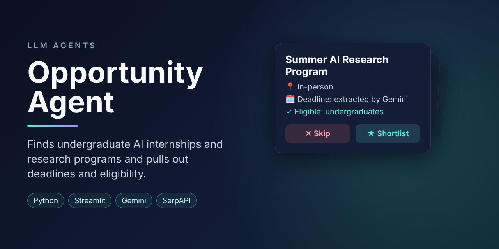

<p align="center"></p>

<p align="center">
  <a href="https://github.com/shahmahmudhasanrhythm/ai-opportunity-agent/actions/workflows/tests.yml"></a>
  
  
</p>

A Streamlit app that finds **undergraduate AI internships, research programs, fellowships and hackathons**, reads each posting with Gemini, and lets you sort through them like a swipe deck.

I built it because, as a first-year student, I was spending hours on searches that mostly returned PhD and senior roles.

## Features

- **Targeted search:** builds Google queries (via SerpAPI) by opportunity type, country and year of study, filters out PhD, master's and senior roles, and only keeps pages from the last 6 months
- **AI extraction:** Gemini reads each page and pulls out eligibility, location, deadline, sponsorship, requirements and a contact name, then looks up the contact on LinkedIn
- **Five tabs:** Swipe Deck (shortlist or skip), Master Sheet, 24-hour Intelligence Feed, AI Assistant chat, and an AI Toolbox directory
- **Model fallback:** retries across Gemini models when one is rate-limited or retired (one shared client in `agent/gemini.py`)
- **Honest feed:** the Intelligence Feed only reports what the live search actually found, with links
- **Free persistence:** results are saved as CSV and committed back to this repo through the GitHub API, so data survives Streamlit Cloud restarts

## Tech stack

Python · Streamlit · Google Gemini API · SerpAPI · DuckDuckGo Search · pandas · BeautifulSoup · GitHub REST API

## Run it locally

```bash
git clone https://github.com/shahmahmudhasanrhythm/ai-opportunity-agent
cd ai-opportunity-agent
pip install -r requirements.txt
```

Create `.streamlit/secrets.toml` (it's in `.gitignore`, so it never gets committed):

```toml
SERPAPI_KEY = "..."
GEMINI_API_KEY = "..."
GITHUB_TOKEN = "..."   # optional, for saving to the repo
```

```bash
streamlit run app.py
```

Optional: add a `[profile]` section to `secrets.toml` so the eligibility check fits you:

```toml
[profile]
nationality = "Bangladeshi"
visa = "Chinese X1 student visa"
location = "Studying in China"
```

## Project structure

```
app.py               Streamlit UI
scraper.py           SerpAPI gatherer (run by the app as a subprocess)
agent/
  config.py          models, profile defaults, column names
  gemini.py          one Gemini client with model fallback
  extraction.py      page scraping, analysis prompt, robust field parser
  search.py          query builder (auto-targets next summer from August)
  evaluation.py      how predictions are compared with gold labels
eval/                measure extraction accuracy on postings you labelled
tests/               pytest unit tests
```

## Tests and evaluation

```bash
pip install -r requirements-dev.txt
pytest                                   # unit tests, no API keys needed

cp eval/labels_template.csv eval/labels.csv   # then label ~30 real postings
GEMINI_API_KEY=... python -m eval.evaluate_extraction
```

| Field | Accuracy on my 30 labelled postings |
|---|---|
| Eligibility | *run it* |
| Location | |
| Deadline | |
| Contact | |

## Roadmap

- [ ] Move from CSV-in-git to SQLite or Supabase
- [ ] Email digest of new matches each week
- [x] Evaluation harness for extraction accuracy (now label the postings!)
